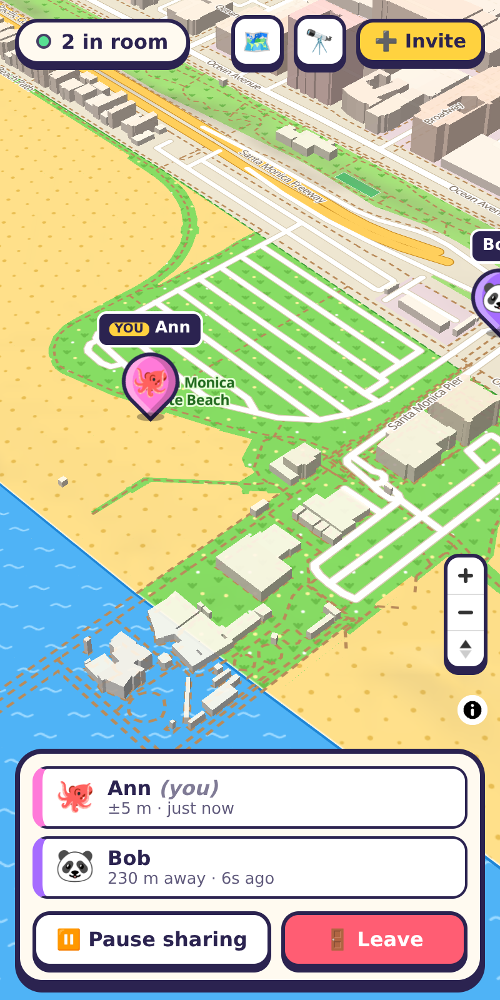

# Group Map Share

Live location sharing for a group, with no accounts, no phone numbers and no app to install.

1. Someone taps **Create a room** and gets a QR code (and a share link).
2. Everyone who scans it lands in the web app, types a name and picks a character.
   Before any map is shown, the app asks for location so the map opens where you are.
   If you decline, it opens on your part of the world (guessed from your time zone).
3. Everyone appears as a bouncing game-style pin on a shared map, live.

The map is a custom "game board" style over free OpenStreetMap vector tiles. Water, sand/beach,
grassland, parks, forest, farmland, wetland, town and buildings each get a bold colour and a
small pattern (waves, sand dots, grass tufts, trees), plus hillshading. Tap 🗺️ for the legend.



## Run it

Needs Node 22.18+ (it runs the TypeScript server directly with Node's type stripping).

```bash
npm install
npm run dev        # Vite on http://localhost:5173, realtime server on :8787 (proxied)
```

Production-style, one process serving the built app and the WebSocket on one port:

```bash
npm run build
npm start          # http://localhost:8787
```

| Env var     | Default   | Meaning                         |
| ----------- | --------- | ------------------------------- |
| `GMS_PORT`  | `8787`    | Port for the HTTP/WebSocket server |
| `GMS_HOST`  | `0.0.0.0` | Interface to listen on          |

These are deliberately not `PORT`/`HOST`, which dev machines often already use for something else.

### Testing without walking around

Add `?sim` to any URL to replace GPS with a fake position that wanders around Santa Monica beach,
or `?sim=LAT,LNG` to start somewhere specific. Open two browser windows (or one normal and one
private window) on the same room link to see two players.

```bash
npm test           # room logic, a real two-client WebSocket session, and map-style validation
npm run typecheck
```

### Phones need HTTPS

Browsers only allow geolocation on secure origins. `localhost` counts, but a phone hitting
`http://192.168.x.x:5173` does not. To try it on a phone, put it behind HTTPS (a reverse proxy,
a tunnel, or your platform's TLS).

## How it works

```
src/            React front end (Vite)
  App.tsx         landing → room page (join card, HUD, invite QR, legend)
  MapView.tsx     MapLibre map, pins, smooth gliding between updates
  mapStyle.ts     the game-board map style + terrain patterns (also feeds the legend)
  useRoom.ts      WebSocket client with auto-reconnect
  useGeolocation.ts  watchPosition wrapper (+ ?sim mode)
server/
  index.ts        HTTP API, static file serving, WebSocket relay
  rooms.ts        in-memory rooms: join/rejoin, positions, expiry
shared/protocol.ts  message types shared by both sides
```

- `POST /api/rooms` creates a room with a random 128-bit id. The link *is* the key, so treat it
  like a private invite.
- Clients connect to `/ws?room=<id>`, send `hello` (name, avatar, colour) and then `pos` updates
  from `navigator.geolocation.watchPosition`. The server relays each update to the room.
- A per-tab session token lets a reload or a dropped connection resume the same player.
  A player whose connection drops is shown greyed out, then removed after 5 minutes.

## Privacy

- Nothing is written to disk. Rooms and positions live only in server memory and are gone on restart.
- Location is sent only after the user taps **Join & share my location**, and only while the page is open.
- **Pause sharing** hides your pin and makes the server forget your last position. **Leave** removes you entirely.
- Rooms are deleted after 30 minutes with nobody connected.
- Names are plain text (rendered with `textContent`), capped at 24 characters. Messages are size-limited,
  and position updates are throttled.
- Pages send `no-referrer`, so room ids don't leak to the tile servers.

## Map data

Vector tiles: [OpenFreeMap](https://openfreemap.org) (OpenMapTiles schema, © OpenStreetMap contributors).
Hillshade: Mapzen/AWS Terrain Tiles. Low-zoom relief: Natural Earth. None need an API key.
